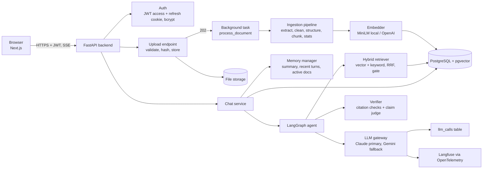
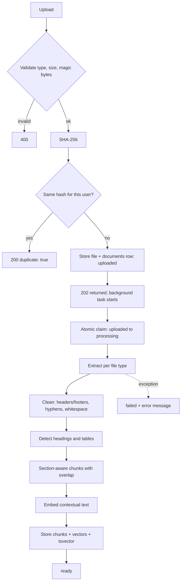
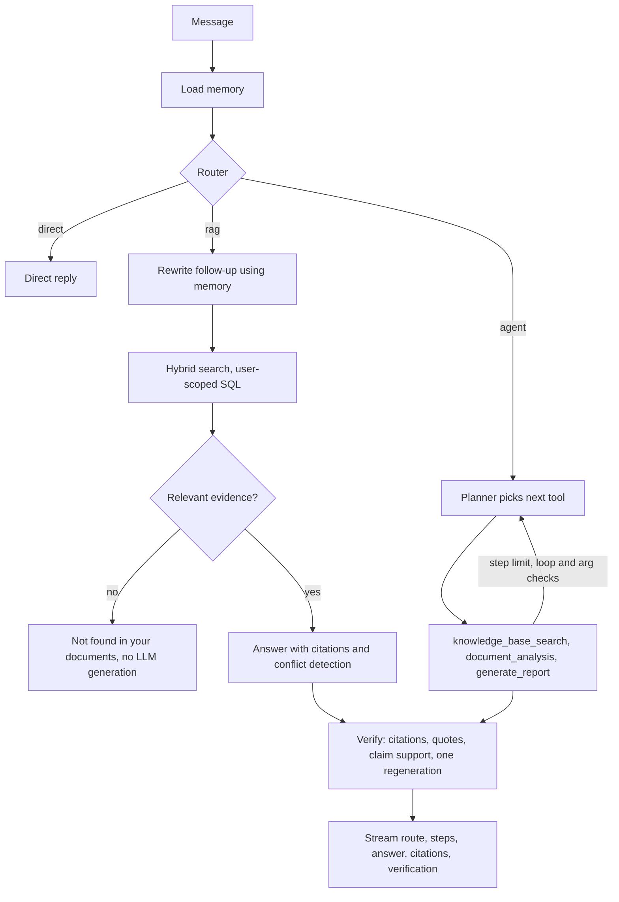

# Architecture

## Components

## Upload flow (no AI until the embedding step)

## Question flow

## Key decisions

| Decision | Why |
|---|---|
| Postgres + pgvector, not a vector DB | One database for users, documents, chunks, vectors and logs; `user_id` filters are plain SQL; transactional consistency; full-text search is built in for the keyword half of hybrid search |
| Hybrid search with Reciprocal Rank Fusion | Embeddings capture meaning, keywords capture exact identifiers (ERR-4471, INC-102); RRF needs no score normalisation |
| LangGraph for the agent | Explicit state, conditional edges, step limits and loop detection are visible and testable |
| Deterministic ingestion | Parsing, cleaning, chunking and counting never call an LLM, so they are cheap, fast and reproducible |
| Gateway with fallback | Every LLM call goes through one place: retries, circuit breaker, provider fallback, structured-output validation and logging |
| Relevance gate before generation | No evidence means no generation, which saves tokens and prevents hallucination |
| Tenant isolation in SQL | Ownership is in the `WHERE` clause (never a Python post-filter); another user's row is a 404; agent tools get `user_id` from server state, never from LLM output |

## Reliability and safety features

- Retries with backoff, a per-provider circuit breaker, fallback provider, one structured-output repair retry.
- Agent: max steps, per-tool and overall timeouts, Pydantic argument validation with repair, loop detection, partial results.
- Prompt injection: ingestion-time flagging, delimited and labelled untrusted sources with extra warnings on flagged chunks,
  output checks for prompt leakage and unsourced links.
- Verification: deterministic citation and quote checks plus an LLM claim check against the sources.
