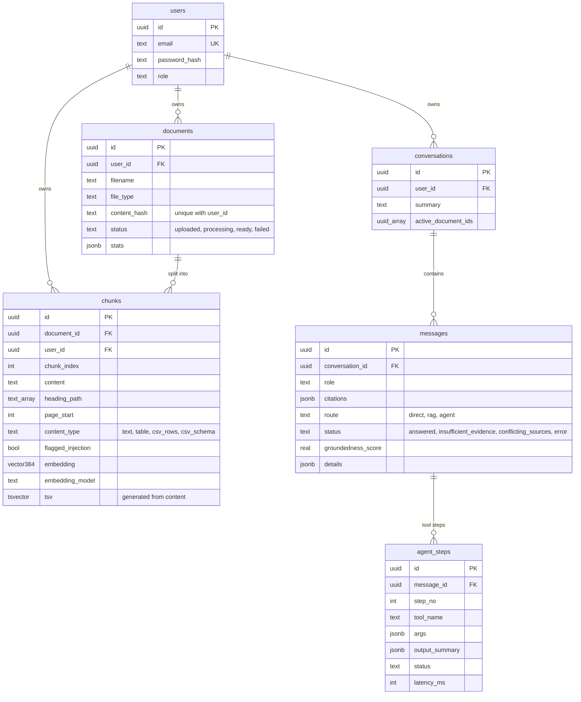

# Database schema

PostgreSQL 16 with the `pgvector` extension. Migrations are in `backend/alembic/versions/`:

| Migration | Change |
|---|---|
| `0001_initial_schema` | All tables, HNSW (cosine) index on `chunks.embedding`, GIN index on `chunks.tsv`, ownership indexes |
| `0002_embedding_384` | `chunks.embedding` from `vector(1536)` to `vector(384)` for the local MiniLM model (discards old vectors; reprocess documents) |
| `0003_message_details` | `messages.details` (model, tokens, latency, verification issues, conflicts) and indexes on `llm_calls`/`activity_logs` |

`llm_calls` (user, conversation, message, task, provider, model, tokens, estimated cost, latency, success, error,
`fallback_used`) and `activity_logs` (user, action, entity, details, level) are append-only logs with no foreign keys, so
history survives deletes.

## Rules

- Every table holding user data has `user_id` with an index, and every query filters on it in SQL.
- `UNIQUE (user_id, content_hash)` makes duplicate detection per user and race-safe.
- `chunks.tsv` is `GENERATED ALWAYS AS (to_tsvector('english', content)) STORED`, so it is not a column in the ORM model.
- Embeddings from different models are never compared: search filters on `chunks.embedding_model`.
- Deleting a user, document or conversation cascades to its chunks, messages and agent steps.
